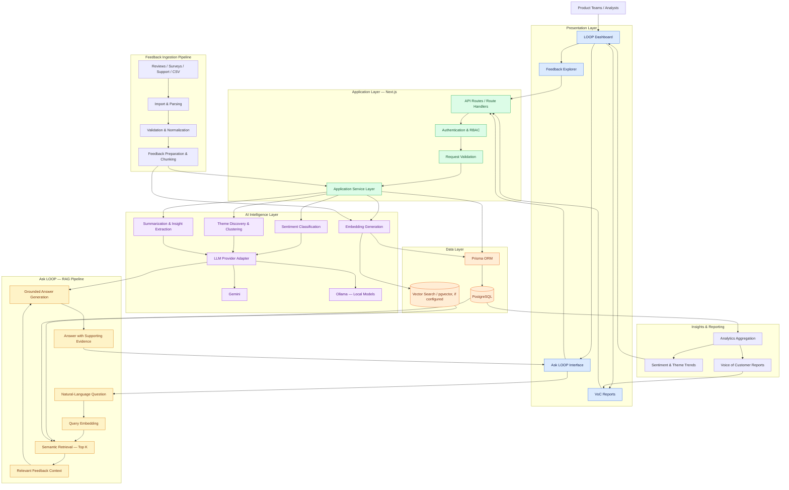

# LOOP — AI Customer Feedback Intelligence Platform

**Turn customer feedback into actionable intelligence.**

LOOP is an AI-powered Customer Feedback Intelligence Platform that transforms unstructured customer reviews, surveys, support conversations, and feature requests into structured insights. It combines sentiment analysis, theme discovery, semantic search, and Retrieval-Augmented Generation (RAG) to help teams understand customer needs and make evidence-based decisions.

Instead of manually analyzing thousands of feedback entries, teams can use LOOP to identify recurring issues, understand customer sentiment, discover emerging trends, and ask natural-language questions about customer experiences.

## Core Capabilities

- **AI-Powered Sentiment Analysis** — Classify feedback and identify positive, negative, and neutral sentiment.
- **Theme Discovery** — Group semantically similar feedback into recurring themes and customer pain points.
- **Ask LOOP** — Ask natural-language questions and receive answers grounded in retrieved feedback.
- **Semantic Search** — Find relevant customer feedback by meaning rather than exact keyword matches.
- **Voice of Customer Reports** — Generate structured summaries of customer concerns, recurring requests, and emerging trends.
- **Feedback Analytics** — Explore sentiment distributions, theme trends, and customer insights through interactive dashboards.
- **Feedback Ingestion** — Import and process customer feedback from supported data sources, including CSV files.
- **Workspace Access Control** — Organize users and control access through role-based permissions.

## System Architecture

The following diagram illustrates the end-to-end architecture, from feedback ingestion to AI-powered insights and grounded question answering.

*Architecture note: Gemini and Ollama represent the supported model directions discussed for LOOP. The actual configured provider, vector-search implementation, and deployed services depend on the repository configuration.*

## Ask LOOP: Retrieval-Augmented Generation

Ask LOOP enables users to ask questions about their customer feedback without relying solely on a model's general knowledge.

The intended workflow is:

1. **Ingest:** Collect and normalize customer feedback.
2. **Embed:** Generate vector representations of feedback entries.
3. **Retrieve:** Convert a user's question into an embedding and retrieve the most relevant feedback.
4. **Construct context:** Prepare the retrieved evidence for the language model.
5. **Generate:** Produce an answer grounded in the available feedback.
6. **Present evidence:** Return the answer alongside supporting feedback where supported.

This approach helps users investigate questions such as:

- What are the most common complaints this month?
- Why are customers dissatisfied with onboarding?
- Which product features are customers requesting most frequently?
- What recurring issues appear in negative feedback?
- Has sentiment around a particular feature changed over time?

## Technology Stack

| Layer | Technologies |
|---|---|
| Frontend | Next.js, React, TypeScript |
| Styling | Tailwind CSS |
| Backend | Next.js API Routes / Route Handlers, Node.js |
| Data access | Prisma ORM |
| Database | PostgreSQL |
| Vector search | pgvector, where configured |
| AI models | Gemini and Ollama/local models |
| AI techniques | Embeddings, semantic search, sentiment analysis, RAG |
| Visualization | Recharts |
| Validation | Zod |
| Deployment | Vercel-compatible deployment, depending on configuration |

## Data Flow

### Feedback analysis

Customer feedback → ingestion → validation and normalization → AI classification and theme discovery → persistence → analytics and reports.

### Question answering

User question → query embedding → semantic retrieval → relevant feedback context → LLM response → answer with supporting evidence.

### Analytics and reporting

Persisted feedback and analysis results → aggregation → trend analysis → dashboard visualizations and Voice of Customer reports.

## Security and Access Control

LOOP is designed around workspace-oriented access and role-based permissions.

- Authentication and authorization at the application boundary.
- Workspace isolation for customer data.
- Role-based access for administrative and analytical operations.
- Server-side execution of model requests and protected credentials.
- Request validation and structured error handling.
- Careful handling of customer feedback and other potentially sensitive information.

The exact enforcement mechanisms should match the application's implemented authentication and database authorization logic.

## Project Goals

LOOP aims to make customer feedback more useful by helping teams:

- Reduce manual feedback analysis.
- Discover recurring customer pain points.
- Understand sentiment and feature demand.
- Support product decisions with real customer evidence.
- Investigate feedback using natural-language questions.
- Turn unstructured feedback into measurable, actionable insights.

## Roadmap

Potential areas for continued development include:

- Additional feedback-source integrations.
- Improved theme quality and cluster evaluation.
- Historical trend comparisons and anomaly detection.
- More comprehensive evaluation of RAG answer quality and groundedness.
- Feedback prioritization based on frequency, severity, and business impact.
- Advanced workspace-level analytics and reporting.

## Contributing

Contributions should maintain clear separation between application logic, AI services, data access, and presentation.

1. Review the existing architecture and coding conventions.
2. Create focused changes with appropriate tests.
3. Validate model integrations and error handling.
4. Avoid exposing credentials or sensitive customer data.
5. Update documentation when behavior or configuration changes.

## License

Refer to the repository's `LICENSE` file for applicable licensing terms.

---

**LOOP — Listen to your customers. Understand the patterns. Make better decisions.**
